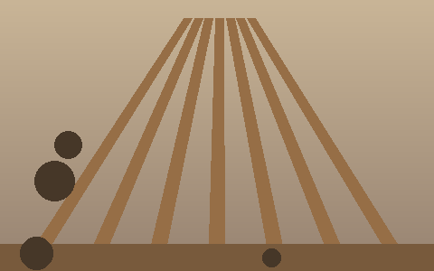
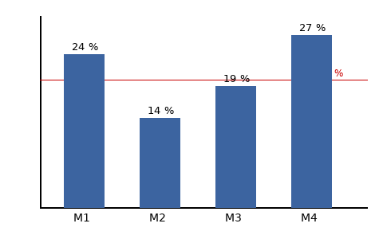

# Prüfbericht Dachstuhl Haus Nr. 12

::: zusammenfassung
Der Dachstuhl ist tragfähig. An der Nordseite sind Sparren und Mauerbank zu feucht; die Sanierung kostet rund 6.700 Euro netto.
:::

## Befund {#Befund}

Begehung am 9. Oktober 2026 mit dem Eigentümer. Die Holzfeuchte wurde an vier Punkten gemessen[^1]; die Werte stehen im Abschnitt [Messwerte](#Messwerte) und in [Tabelle 1](#tabelle-holzfeuchte).

### Feuchteschäden

Feuchteflecken am Sparren Nord und an der Mauerbank, siehe [Abbildung 1](#abbildung-dachstuhl).

{#abbildung-dachstuhl}

- Sparren Nord
  - Flecken auf 1,2 m Länge
  - Oberfläche weich
- Mauerbank Nord
- Pfette, nur im Randbereich

### Holzschädlinge

Kein Befall durch Hausbock oder Anobien festgestellt.

## Messwerte {#Messwerte}

Gemessen in 2 cm Tiefe bei 8 °C Lufttemperatur[^2].

| Messpunkt | Bauteil | Holzfeuchte % | Bewertung |
|---|---|---:|---|
| M1 | Sparren Nord | 24 | zu feucht |
| M2 | Sparren Süd | 14 | in Ordnung |
| M3 | Pfette | 19 | Grenzwert |
| M4 | Mauerbank | 27 | zu feucht |

Table: Tabelle 1: Holzfeuchte je Messpunkt {#tabelle-holzfeuchte}

## Kosten

| Gewerk | Leistung | Betrag |
|---|---|---:|
| Zimmerei | Sparren ersetzen | 4.800,00 |
| Spengler | Rinne erneuern | 1.250,00 |
|  | Anschluss Kamin | 640,00 |
| Summe netto |  | 6.690,00 |

Table: Tabelle 2: Kosten der Sanierung in Euro

## Empfehlung

Die feuchten Bauteile sind zu trocknen oder zu ersetzen. Normen und Merkblätter: [Austrian Standards](https://www.austrian-standards.at/).

### Sofortmaßnahmen

1. Rinne an der Nordseite abdichten
2. Sparren Nord abstützen[^3]
3. Raum täglich lüften

{.dekorativ}

Innsbruck, 13. Oktober 2026

[^1]: Messung mit Widerstandsmessgerät nach ÖNORM B 3802-2.
[^2]: Grenzwert für tragendes Bauholz: 20 Prozent Holzfeuchte.
[^3]: Abstützung nach Angabe des Statikers vom 10. Oktober 2026.
